# PROTOKOLL NULL – Aufstieg eines Agenten

Native Android-RPG im Hochformat (Kotlin + Jetpack Compose, offline, deutsch, minSdk 26).
**Stand: Beta 0.6.0 „Living Division“** – vollständig durchspielbar: Prolog, drei Kapitel, Direktorat und Finale mit vier Enden. Neu in 0.6: Alle Figuren führen ein eigenes Leben mit Laufbahn, Einsätzen, Verletzungen und Freundschaften untereinander; die Gefährtin bzw. der Gefährte wird zur zweiten Hauptfigur; HQ-Ereignisse mit Folgen; Beziehungen 2.0 und zehn neue Alex-Szenen (Details unten und in [docs/LIVING_DIVISION.md](docs/LIVING_DIVISION.md)).

> Privater, nicht-kommerzieller Fan-Prototyp im Universum der Serie *Nikita* (The CW, 2010–2013). Story, Dialoge und Missionen sind eigenständig geschrieben, keine Episodenabschriften. Für eine öffentliche oder kommerzielle Veröffentlichung sind Rechtefreigaben oder eigenständige Figuren nötig.

## Installation (Debug-APK)

1. Im Repository auf **Actions → Android CI** gehen und den neuesten grünen Lauf öffnen.
2. Unten unter *Artifacts* **`ProtokollNull-debug-apk`** herunterladen (ZIP), entpacken.
3. `app-debug.apk` aufs Android-Gerät (Android 8.0+) kopieren und installieren („Unbekannte Quellen“ erlauben).

Die APK wird bei jedem Push auf `main` neu gebaut; vorher laufen alle Unit-Tests, die Inhaltsvalidierung und ein Render-Test aller Kernscreens.


## Neu in v0.6 – Living Division

### Lebendige Division
- **Jede Figur entscheidet täglich selbst** – deterministisch nach Profil, Charakterzügen, Stimmung und Zielen: Dienst, eigenes Training, Freizeit, Einsätze (ab 18), Urlaub; dazu Verletzungen, seltene Versetzungen mit späterer Rückkehr.
- **Eigene Laufbahnen**: Karrierepunkte, Monatsnoten A–E, Prüfungen mit Beförderung oder Durchfallen (30 Tage Wartezeit), Kompetenzen in fünf Bereichen, Einsatzbilanz.
- **Sozialleben untereinander**: Freundschaften und Spannungen nach Interessen und Werten; volljährige NPC-Paare (nie Figuren, die eine Spielerromanze sein können).
- **Anwesenheit nach Status**: Wer im Einsatz, im Urlaub oder versetzt ist, ist nicht im HQ; Verletzte liegen auf der Krankenstation.
- **Divisionsleben-Feed** und Tagesmeldungen zu Beförderungen, Verletzungen, Rückkehr und Paaren.

### Gefährtin/Gefährte als zweite Hauptfigur
- Editor mit Charakterzügen, Interessen, **Werten, Lebensziel und Berufswunsch**.
- **Eigenständige Laufbahn** – Rang aus Training, Noten, Prüfungen und Einsätzen statt aus vergangener Zeit; Laufbahn-Rat durch dich (Vertrauen entscheidet, ob sie/er folgt); eigene Freundschaften in der Division. Eine Beziehung beginnt nie automatisch.

### HQ-Ereignisse
- 27 Ereignisse rund um Michael, Nikita, Birkhoff, Sonya, Amanda, Percy, Alex, Jaden, Thom, Ryan, Owen, Maya, Ethan, Helena und deine Gefährtin/deinen Gefährten – mit echten Folgen: Beurlaubung, Versetzung, Konflikte, Bindungen zwischen Figuren, Percys Druck, Amandas Beobachtung. Wer nicht reagiert, entscheidet auch.

### Beziehungen 2.0
- **Passung** mit Begründung, **Meilensteine**, **strukturierte Erinnerungen** mit Zusammenfassung älterer Ereignisse.
- **Geschenke nach Interessen** mit vorhergesagter Reaktion; **Konflikte** mit Aussprache.
- **Mehrere mögliche Partner** in der Annäherungsphase, eine **feste Beziehung nur durch bewusste Entscheidung** (Bestätigung, andere Annäherungen enden respektvoll); „Nur Freunde bleiben“ und Trennung als eigene Entscheidungen.
- **Romantik weiterhin nur, wenn beide Figuren volljährig sind.**

### Alex-Route
- Zehn neue Szenen: Freundschaft ab 16 (Rangliste, Kopfhörer, drei Uhr morgens, Narben, Beförderung, Alex' 18. Geburtstag), ein vollständiger Freundschaftsweg („Familie, die man sich aussucht“, „Noch einmal ehrlich“), eine Romanzenszene ab 18 und ein gemeinsames drittes Kapitel.

## Neu in v0.5 – Karriere, Zeitplan, Ausrüstung

### Karriere & Ausbildung
- **Leistungsbeurteilung durch Michael** (Note A–E) aus tatsächlichen Leistungen der letzten 30 Tage: Trainingseinheiten, Einsätze, Entwicklung der Attribute, Prüfungsvorbereitung, Verfassung. Anforderbar alle 30 Tage, im Zeitplan automatisch monatlich.
- **Beförderungen zu Rang 2–7 erfordern eine aktuelle Beurteilung ≥ C.** Ränge 5–11 bleiben zusätzlich an Story-Missionen gebunden.
- **Mehrphasige Beförderungsprüfung** im Direktorat: Theorie → Praxis → Lageentscheidung (drei Antworten, eine fachlich beste) → Urteil (Michaels Vertrauen + Beurteilung). Bestanden ab 60 Punkten. Nicht bestanden: Auflage zur Prüfungsvorbereitung und 14 Tage Wartezeit – nie eine Sackgasse.
- **Michael als Mentor**: Einzeltraining an deiner Schwäche, Prüfungsvorbereitung (je einmal pro Tag, Vertrauen ≥ 45, nur wenn er anwesend ist).
- **Trainingsplaner**: Ausbilder (Michael, Owen, Birkhoff, Sonya, Amanda, Ryan – nur wenn anwesend, Bonus nach Vertrauen und Kompetenz), Intensität (Leicht/Normal/Intensiv mit Verletzungsrisiko), Tageslimit (danach Ermüdung), persönliche Trainingsziele.
- **Karrierejournal** (Beurteilungen, Prüfungen, Beförderungen, Ziele, Geburtstage, Auszeichnungen) und **Freischaltungen je Dienstgrad** (z. B. Rabatt ab Rang 6, Geheimarchiv ab Rang 7, Teambefehl ab Rang 8, Delegieren ab Rang 9).

### Zeitplan & Simulation
- Ersetzt den alten Zeitraffer. Du legst für jeden Wochentag eine Tätigkeit fest (Kampftraining, Technik, Aufklärung, Sozialleben, Erholung, Dienst, Prüfungsvorbereitung) und simulierst 1/7/30/90/365 Tage oder bis zum 18. Geburtstag.
- Tag für Tag: Energie, Stress, Erfolg der Einheit, Ausbilder vor Ort, Attributfortschritt mit abnehmendem Ertrag, XP sinkend mit Level, Wundheilung (7 Heiltage pro Wunde, Erholung schneller), Sold/Miete wöchentlich, Dienstzulagen, Ruf aus Dienst gedeckelt.
- Beziehungen ändern sich nur durch tatsächliche Begegnungen mit bekannten, anwesenden Figuren; lange ohne Kontakt schläft eine Freundschaft leicht ein. Zufallsbegegnungen höchstens dreimal je Ereignis.
- **Anhalten bei wichtigen Ereignissen**: 18. Geburtstag (inkl. Gefährtenankunft), neue Story-Ereignisse, kritische Gesundheit, erfüllte Prüfungsauflage. Story-Ereignisse gehen nie verloren.
- Ausführlicher **Bericht** (Training, Attribute, XP/Level, Gesundheit/Wunden/Stress, Einnahmen/Ausgaben, Begegnungen, Ereignisprotokoll). Deterministisch: gleicher Seed + gleicher Plan = gleicher Spielstand.

### Inventar & Ausrüstung
- **Vier speicherbare Ausrüstungsprofile** (Aufklärung, Analyse, Erste Hilfe, Taktische Unterstützung); Anlegen holt Teile aus dem Spind und prüft Rangfreigaben und Gewicht.
- **Direkter Vergleich** mit dem ausgerüsteten Gegenstand (Boni, Schutz, Wirkung, Tragkraft, Gewicht, Zustand).
- **Situative Gegenstandsboni in zehn Missionsoptionen** (z. B. Kamera beim Beweisfoto am Hafen, Erste-Hilfe-Set bei Versorgung, Laptop bei der Entschlüsselung); ausgerüstet voller, im Inventar halber Bonus.
- Kein Kauf-/Rückgabe-Gewinn möglich (getestet), Rangrabatt ab Rang 6. Alle 42 Gegenstände haben ein vorhandenes Bild; ein neutraler Platzhalter mit Asset-ID erscheint nur, falls eine Datei fehlt (siehe `docs/MISSING_ITEM_ART.md`).

### Beziehungen
- **Romantische Optionen gibt es ab v0.5 nur, wenn beide Figuren volljährig sind.** Die 18/16-Regel aus v0.4 wurde nicht übernommen. Alex-Route (ab 18), Gefährtenakte und alle Erwachsenen-Stufen bleiben erhalten; frühere Beziehungsstufen aus alten Spielständen werden als „pausiert“ angezeigt.

### Private Serienporträts
- Lokale Bildauswahl pro Serienfigur über den Android-Fotopicker (PR #2), ohne Upload; wird in Dialogen, Personalakten und allen NPC-Porträts verwendet. Details: [private Serienporträts](docs/PRIVATE_CAST_PORTRAITS.md).

## Screenshots

Automatisch von Robolectric/Roborazzi aus echtem Spielzustand gerendert (Workflow *Screenshots*, Ordner `docs/screenshots/`). Fotos und Item-Icons werden in der Testumgebung synchron geladen und sind daher sichtbar.

| Start | Charaktereditor | Prolog | Dialog |
|---|---|---|---|
|  |  |  | 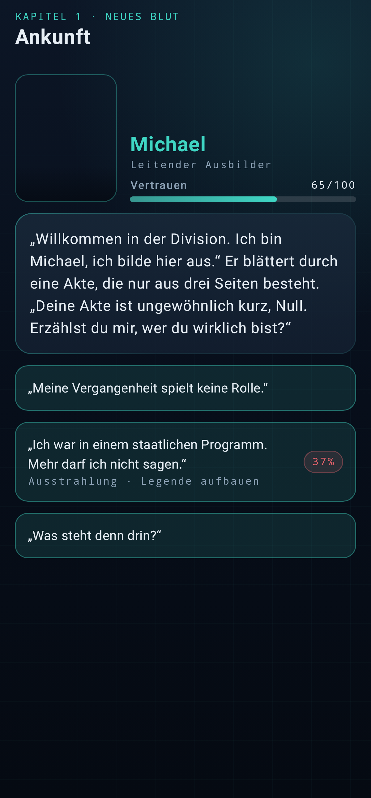 |
| **HQ-Lageplan** | **Einsatzboard** | **Briefing** | **Mission** |
| 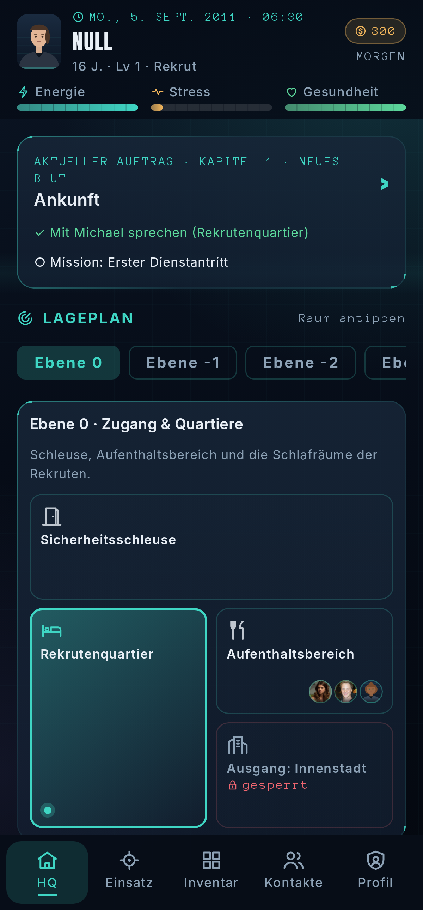 |  |  | 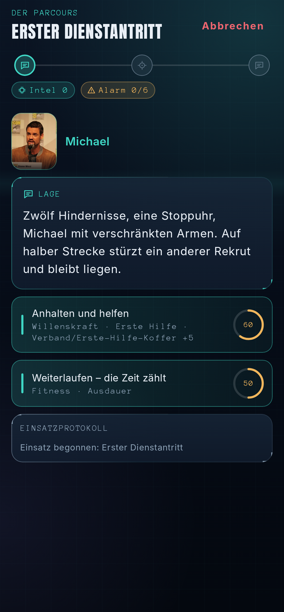 |
| **Taktikbrett** | **Nachbesprechung** | **Untersuchung** | **Inventar** |
|  | 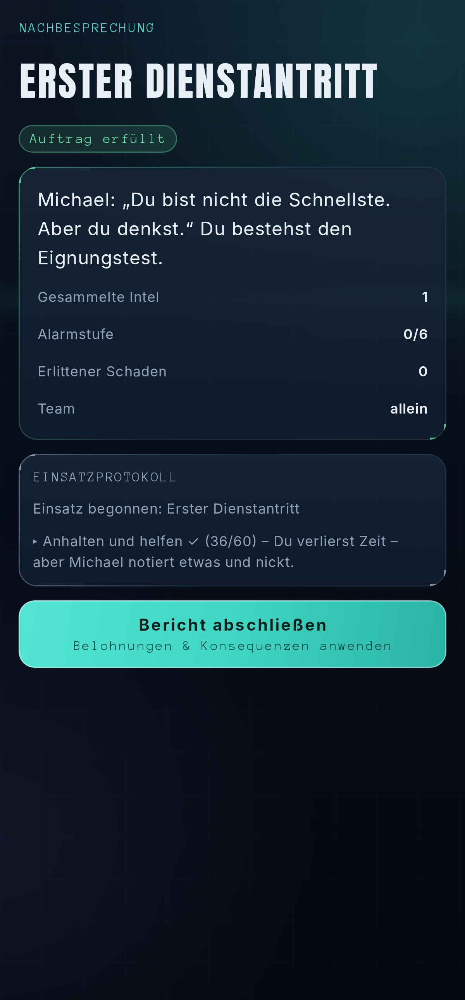 | 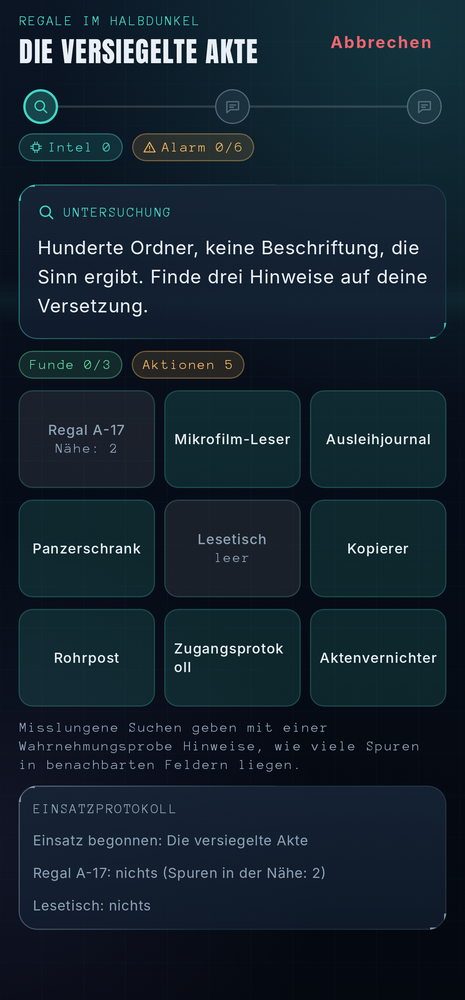 |  |
| **Gegenstand** | **Ausrüstungskammer** | **Kontakte** | **Personalakte** |
| 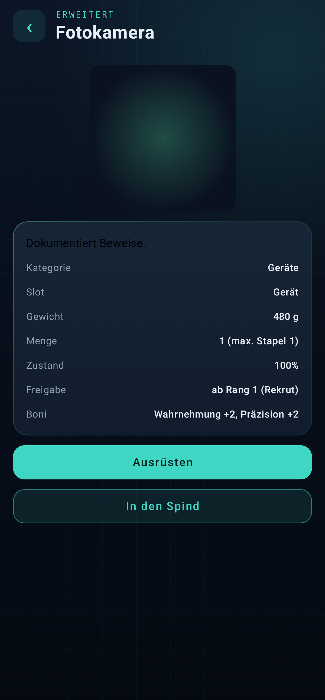 |  |  |  |
| **Profil** | **Skilltree** | **Karriere/Ränge** | **Zeitplan** |
|  |  |  | 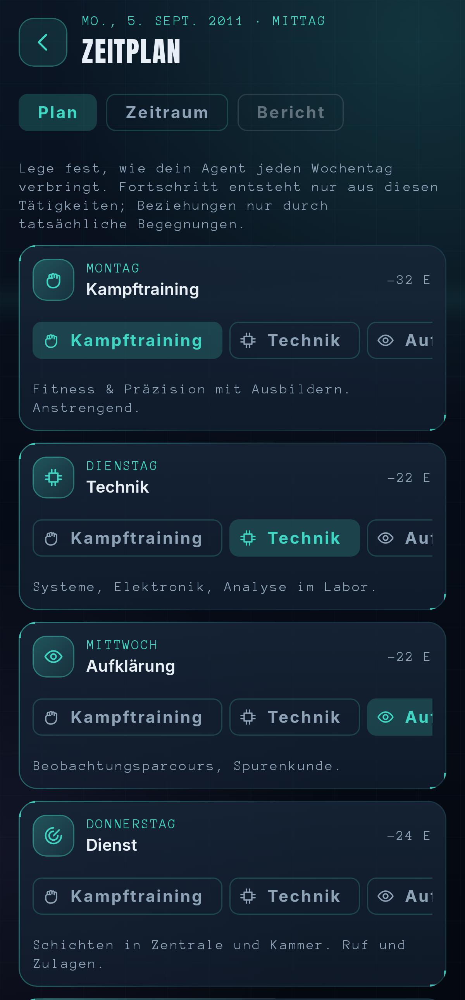 |
| **Rekrutierungseditor (ab 18)** | **Direktorat** | **Spielstände** | **Epilog** |
| 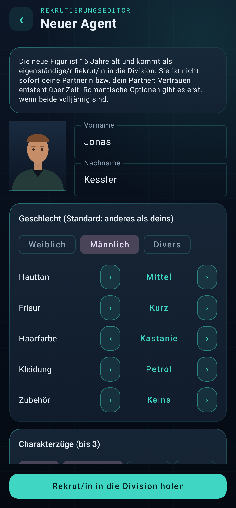 | 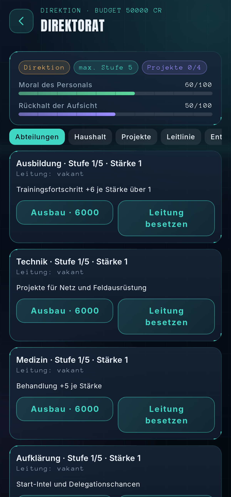 | 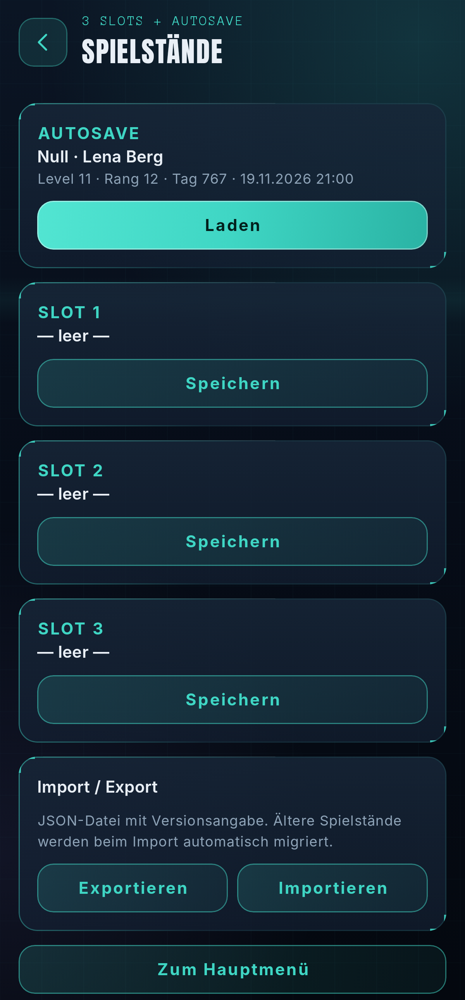 | 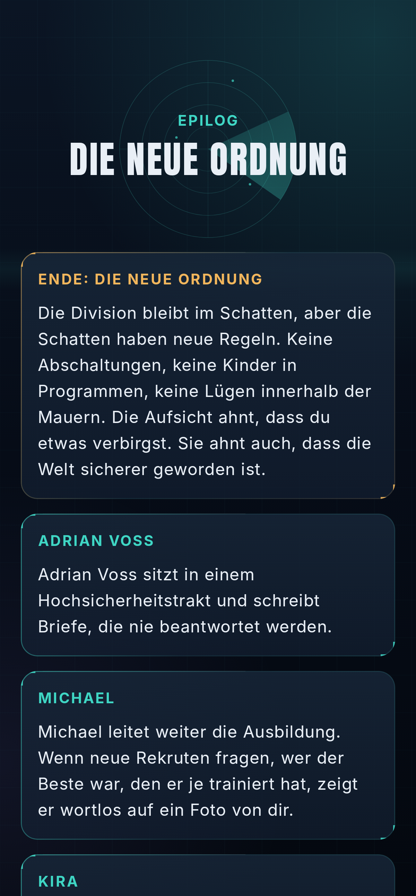 |
| **Zeitplan-Bericht (v0.5)** | **Karriere (v0.5)** | **Trainingsplaner (v0.5)** | **Prüfung (v0.5)** |
| 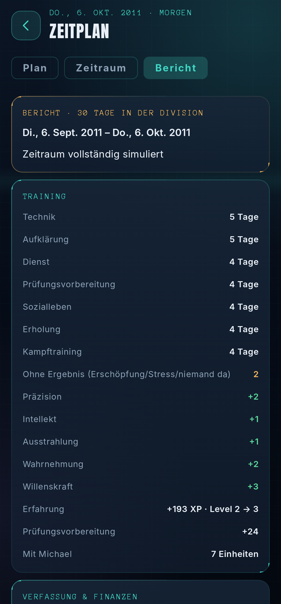 |  |  |  |
| **Ausrüstungsprofile (v0.5)** | **Kontakte mit Status (v0.6)** | **Personalakte · Laufbahn (v0.6)** | **Beziehung & Erinnerungen (v0.6)** |
|  |  |  |  |
| **Umfeld (v0.6)** | **Heute in der Division (v0.6)** | **HQ-Ereignis (v0.6)** | |
|  |  | 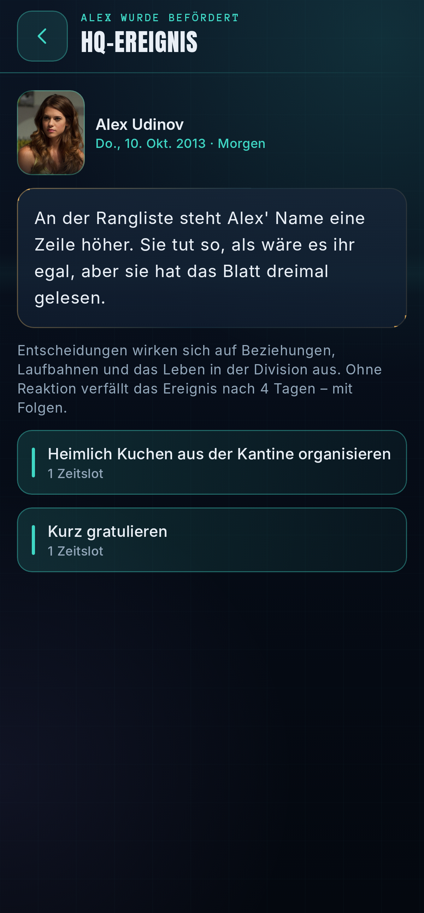 | |

## Was ist spielbar? (ehrlicher Stand)

### ✅ Spielbar
- **Start-/Fortsetzen-Menü**, 3 Speicherslots + Autosave nach jeder Aktion, atomare Speicherung, Import/Export als JSON, automatische Migration alter Foundation-Spielstände (Schema 1 → 2).
- **Charaktereditor** mit lokalem Fotoimport, Schnellstart über Vorgabewerte und optionaler Gefährtenakte: Name, Deckname, Geschlecht, Auftreten, prozeduraler Original-Avatar (Hautton, Frisur, Haarfarbe, Augen, Kleidung, Zubehör), PHOENIX-Hintergrund, Stärke/Schwäche, Schwierigkeitsgrad.
- **Prolog 13–16 Jahre** mit 21 Szenen, von denen du pro Durchlauf 13 erlebst; Entscheidungen setzen Attribute und Story-Flags (z. B. Gehorsam/Widerstand gegenüber Voss).
- **Kapitel 1 „Neues Blut“** komplett: 9 Quests, **10 handgeschriebene Missionen** (M001–M010) mit Briefing, Vorgehenswahl, Team, Ausrüstungsboni, Abbruch-/Fehlpfaden, Nachbesprechung und Konsequenzen; Kapitelabschluss im Direktorat mit mehreren Ausgängen.
- **Missionstypen**: Entscheidungen mit transparenten Erfolgschancen, Untersuchung (Suchraster mit Hinweisen), Observation (Muster erkennen), Undercover (Tarnungswert), Rettung und **rundenbasiertes abstraktes 2D-Taktikbrett** (Deckung, Bewegung, AP, Status, Teamfähigkeiten, Gegner-KI, deterministische Würfe).
- **Missionsgenerator**: wöchentliches Einsatzboard aus Seeds (Ort, Fraktion, Zeugen, Risiko, Zielperson). Unter 18 nur Gespräche, Untersuchungen und Observationen mit Gefahr ≤ 2.
- **Erkundbares 2D-HQ**: 4 Ebenen, 13 Räume als antippbarer Lageplan, Zutritt nach Rang/Alter/Sicherheitskarte, Raumaktionen, **NPC-Tagespläne** (wer ist wann wo), zufällige Begegnungen.
- **Kalender**: 6 Zeitslots pro Tag, Schlafen/Ausruhen, Erschöpfung ohne Schlaf, Wochensold, Geburtstage, **Zeitraffer** (Woche/Monat/3 Monate/bis 18) in geschlossener Form mit Routinen – keine 365-fach-Schleifen.
- **Werte**: Energie, Stress, Gesundheit, Wunden, Regeneration (Krankenstation, Psychologie, Café, Wohnung).
- **Progression**: Level 1–100, 6 Attribute mit Level-abhängigem Limit, Training mit Partnerbonus, **12 Ränge** mit Level/Alter/Ruf/Vorgesetzten-Vertrauen/Missionen/Story und Prüfung im Direktorat.
- **Skilltree**: 9 Bäume, 36 Fähigkeiten (aktiv/passiv, Levelgrenzen, Voraussetzungen, Meisterperks mit baumübergreifenden Anforderungen), scroll- und zoombar.
- **Inventar** mit Gegenstandsbildern (38 SVGs), 6 Ausrüstungsslots mit Attributboni, Stapeln, Seltenheit, Zustand/Verschleiß, Gewicht/Tragkraft, Spind-Lager, Filter, Detailansicht, Verbrauchsgegenstände, **Ausrüstungskammer** (Anfordern/Warten/Zurückgeben, Rangfreigaben).
- **Beziehungen**: Freundschaft, Vertrauen, Loyalität, Respekt, Zuneigung, Rivalität, Erinnerungen; 22 handgeschriebene, verzweigte Dialoge mit Bedingungen und Proben; Smalltalk, Zeit verbringen, Rat, Geschenke, Wettkämpfe gegen Rivalen.
- **Romanze (altersgerecht)**: nur mit fiktiven Figuren (Maya, Ethan, eigene Rekruten). Zwischen zwei Minderjährigen nur gemeinsame Zeit/Vertrauen/Gespräche, keinerlei sexualisierte Inhalte; zwischen Volljährigen und Minderjährigen grundsätzlich gesperrt. Ab beiderseits 18: Paar, Zusammenziehen (eigene Wohnung), Heirat, Familie.
- **Rekrutierungseditor ab 18**: neue/r 16-jährige/r Agent/in (Standard: anderes Geschlecht) mit Name, Avatar, Charakterzügen, Hintergrund, Startberuf, Interessen und Fähigkeiten; eigenständiger NPC mit Tagesplan, Karriere und Mentoring – nicht sofort Partner/in.
- **Team**: Teamgröße nach Rang, Teammitglieder kämpfen im Taktikmodus mit eigenen Fähigkeiten; ab Rang 8 Teambefehl, ab Rang 9 Delegieren von Aufträgen.
- **Direktorat (Rang 12)**: Budget, 5 Abteilungen mit Ausbau und Leitung, Moral, Aufsicht, Leitlinien, wöchentliche Abrechnung; Abteilungsboni wirken auf Training, Heilung, Intel und Alarm.
- **Ziviles Doppelleben** ab 17/18: Tarnjob, eigene Wohnung, Innenstadt.
- **Einstellungen**: Schriftgröße (S–XL), Animationen, Effektlautstärke, hoher Kontrast, Haptik. **Credits** mit Bild-/Lizenz- und KI-Hinweisen.

### ✅ Neu in 0.3 (Vervollständigung)
- **Kapitel 2 „Protokoll Null“** und **Kapitel 3 „Schattenrat“**: insgesamt 22 Story-Missionen (M001–M022), 19 Quests, 34 Dialoge; neue Figuren Kira (ehemalige Kandidatin 4, später Teammitglied/Romanze ab 18) und Helena (Maulwurf, kann umgedreht werden).
- **Ränge 5–11 sind an Story-Missionen gekoppelt** (z. B. Teamleiter erst nach „Feuerprobe“).
- **Finale**: letzte Entscheidung als Direktor/in mit **vier Enden** (Im Licht, Die neue Ordnung, Phönix, Spurlos) und einem **dynamischen Epilog**, der Voss’ Schicksal, Michael, Partner/Familie, Kira, Nikita, Birkhoff, Percy und deine Bilanz berücksichtigt. Danach freies Spiel.
- **Design 2.0**: eigene Schriften (Anton, Inter, Anonymous Pro – OFL), eigene Vektor-Icons, Glas-Panels mit Eckmarken, Scanline-Hintergrund, Radar-Emblem, kinoartige Dialoge mit Schreibmaschinentext, Chancen-Ringe, Phasen-Stepper, Raum-Icons und Anwesenden-Miniaturen im Lageplan, überarbeitetes Taktikbrett.
- **Musik**: prozedural erzeugte, eigene Ambient-Musik (Lautstärke in den Einstellungen, pausiert im Hintergrund).

### 🟡 Bewusst offen
- **Serienstills**: Umschalter eingebaut, aber keine Stills im Repo, da keine Nutzungsrechte vorliegen (siehe unten).
- Kein Sprachausgabe/Voice-Over, keine aufgenommene Musik; Tablet-Layouts und weitere Sprachen geplant.

## Figuren-Porträts und Bildrechte

- **Serienfiguren** (Michael, Nikita, Alex, Birkhoff, Amanda, Percy, Thom, Jaden, Owen, Sonya, Ryan): CC-lizenzierte Fotos der Darsteller von Wikimedia Commons (`app/src/main/assets/cast/`, Credits in `assets/CAST_IMAGE_CREDITS.json`). Das sind keine Serienstills und keine Rechte an den Figuren.
- **Serienstills**: Die Szenenbilder in `assets/SERIES_LOOK_REFERENCES.json` sind © The CW bzw. Rechteinhaber und dienen nur als Stilreferenz. Sie werden **nicht** heruntergeladen oder verlinkt. Liegt eine Nutzungserlaubnis vor, kann `app/src/main/assets/cast/show_<id>.jpg` ergänzt und in `app/src/main/assets/licenses/series_image_licenses.json` mit `verified: true`, Lizenz und Nachweis eingetragen werden – erst dann zeigt die App das Still. Ein Test bricht den Build ab, wenn ein `show_*.jpg` ohne Lizenznachweis auftaucht.
- **Originalporträts und Schauplätze**: Die fünf Porträts von Voss, Maya, Ethan, Kira und Helena und die neun Szenenbilder wurden für das Spiel mit OpenAI ImageGen erstellt. Für selbst erstellte Figuren stehen ein prozeduraler Avatar und der lokale Fotoimport zur Wahl.
- **Gegenstände**: 32 Icons von game-icons.net (CC BY 3.0, Hintergrund entfernt), 6 eigene Original-Icons (CC0); siehe `assets/ITEM_IMAGE_CREDITS.json`.
- **Schriften**: Anton, Inter, Anonymous Pro (SIL OFL 1.1), Lizenztexte in `app/src/main/assets/licenses/fonts/`.
- **Musik/Icons der Oberfläche**: eigene Erstellung.

## Technik

- Kotlin 2.0, Jetpack Compose (Material 3, eigenes dunkles Designsystem), AGP 8.7, Gradle-Wrapper 8.9, compile/targetSdk 35, minSdk 26.
- Architektur: `model/` (Kataloge + versionierter `GameState`), `engine/` (reine, deterministische Regeln: Clock, Progression, Inventory, Social/Romance, Missions, Tactical, MissionGenerator, Director, Narrative), `data/` (JSON-Kataloge, `SaveRepository` mit atomarer Speicherung und Migration), `ui/` (`GameViewModel` + Compose-Screens).
- Abweichung vom ursprünglichen Plan: statt Room/DataStore/Navigation werden versionierte JSON-Spielstände (atomar per tmp+fsync+rename) und eine Overlay-Navigation im ViewModel genutzt – offlinefähig, testbar und ohne Annotation-Processing.
- Spielinhalte liegen in `app/src/main/assets/game/` (`agents`, `items`, `skills`, `ranks`, `rooms`, `missions`, `quests`, `dialogues`, `story`, `events`, `places`, `factions`).
- Deterministische Würfe (SplitMix64, Seed + Wurfzähler), persistierte NPC-Beziehungen.

### Build lokal
```bash
./gradlew testDebugUnitTest assembleDebug
./gradlew recordRoborazziDebug   # Screenshots nach docs/screenshots
```

### Tests
- `ContentValidationTest`: Kataloggrößen, eindeutige IDs, alle Asset-Pfade, Serienstill-Lizenzregel, Missions-/Dialog-/Quest-Referenzen, unerreichbare Dialogknoten, Prolog-Graph, Kapitel 1 = 10 Missionen.
- `RulesTest`: Level-100-Grenze, Editor ab 18, Romanzen nur unter Volljährigen, Alex-Route ab 18, Vertrauens-Clamp, Itemstapel, Gewichtsgrenze, Ausrüstungsfreigaben, Rang-12-Voraussetzungen, Stress/Energie, Zeitraffer, Save-Roundtrip, Migration, Dialogentscheidungen, Missionsablauf, Taktik-Determinismus, Generator-Altersgrenzen, Prolog → Spiel.
- `V05SystemsTest`: Simulation 1/7/30/90/365 Tage deterministisch, Fortschritt nur aus Tätigkeiten, Beziehungen nur mit bekannten/anwesenden Figuren, Wundheilung, Stopp beim 18. Geburtstag mit einmaliger Gefährtenankunft, Story-Ereignisse bleiben erhalten, kein Rang 12 per Zeitraffer, **10-Jahres-Spielverlauf** mit Invarianten (Kalender, Geld, Beziehungen, Geburtstage genau einmal, Ereignisidentitäten, Save-Roundtrip), Beurteilung, Prüfungsphasen/Auflagen/Wartezeit, Tageslimit/Ausbilderbonus, Mentoring, Ausrüstungsprofile mit Rangsperre, Kauf/Rückgabe ohne Gewinn, Vergleich, Missionsboni, Archiv ab Rang 7, v0.4-Spielstand ohne neue Felder.
- `LivingDivisionTest` (v0.6): Lebenssimulation deterministisch, idempotent und persistent; **10 Jahre Divisionsleben** (Beförderungen, Durchfallen, Einsätze, Verletzungen, Urlaub/Versetzung, NPC-Freundschaften, Paare nur unter Erwachsenen, keine automatische Romanze, Gefährten-Laufbahn, verdichtete Erinnerungen, Save-Roundtrip); Laufbahn hängt vom Charakter ab; Laufbahn-Rat; Anwesenheit nach Status; Rückkehr nach Urlaub; Erinnerungs-Zusammenfassung und Migration aus Schema 2; v0.5-Spielstand ohne Lebensdaten; HQ-Ereignisse mit Folgen, Ablauf mit „ignore“, Wissens-/Ankunftsprüfung; Geschenke nach Interessen; bewusste feste Beziehung, Nur-Freunde, Trennung; Aussprache; Passung; Altersregel; Alex-Szenen; Katalogvalidierung.
- `ScreenshotTest`: rendert 35 Kernscreens mit echtem Spielzustand (Robolectric).

## Changelog

### 0.6.0-beta „Living Division“
- Lebenssimulation aller Figuren mit eigenen Laufbahnen, Einsätzen, Verletzungen, Abwesenheiten, Versetzungen und Sozialleben.
- Strukturierte Erinnerungen mit Zusammenfassung; Schema 3 mit Migration.
- Gefährtin/Gefährte mit Werten, Lebensziel, Berufswunsch und eigenständiger Laufbahn.
- 27 HQ-Ereignisse mit Folgen; HQ-Übersicht „Heute in der Division“.
- Beziehungen 2.0 (Passung, Meilensteine, Geschenke nach Interessen, Konflikte, bewusste Partnerschaft).
- Zehn neue Alex-Szenen mit vollständigem Freundschaftsweg.
- Neue/überarbeitete Screens: Kontakte, Personalakte (Laufbahn, Beziehung, Umfeld), HQ-Ereignis, Gefährten-Editor, Spieler-Interessen.

### 0.5.0-beta
- Karriere 2.0 (Beurteilungen, Mentoring, dreiphasige Prüfungen mit Auflagen, Ziele, Journal, Auszeichnungen, Rangfreigaben).
- Zeitplan-Simulation statt pauschalem Zeitraffer, mit Bericht und Ereignis-Stopps.
- Ausrüstungsprofile, Gegenstandsvergleich, situative Missionsboni, Rangrabatt.
- Neue Screens: Zeitplan-Assistent, Karriereübersicht, Prüfung, Trainingsplaner.
- Romanzen nur unter Volljährigen; private Serienporträts (PR #2) integriert; Robolectric-Tests auf SDK 34 fixiert.


### 0.4.0-beta
- Ein Fundstück vom Bahnhof begleitet dich durch die PHOENIX-Jahre. Entscheidungen über Beweise, Erinnerung und Kira eröffnen spätere Gesprächsoptionen und prägen den Epilog.
- Eigene Fotos lassen sich für die Hauptfigur und die Gefährtenakte übernehmen. Die App verkleinert die Bilder lokal und nimmt sie beim JSON-Export mit.
- Eine vor dem Prolog erstellte Gefährtenakte wird an deinem 18. Geburtstag wirksam. Michael stellt euch persönlich vor. Die neue Figur tritt wie im ursprünglichen Entwurf mit 16 ein. Eine Romanze ist eine spätere gemeinsame Entscheidung, sobald beide volljährig sind.
- Neun eigens generierte Szenenbilder und fünf Originalporträts begleiten Prolog, Einsatzbriefings, Zuteilung und Personalakten. Observationen verwenden erkennbare Zeichenfolgen.

### 0.3.0-beta
- Kapitel 2/3, Finale mit vier Enden, Epilog, neue Figuren, Rang-Story-Kopplung.
- Design 2.0 mit eigenen Schriften/Icons, kinoartigen Dialogen, prozeduraler Musik.
- Screenshot-Tests laden Bilder synchron.

### 0.2.0-beta
- Gradle-Wrapper, GitHub-Actions-CI mit Tests, Render-Smoke-Test und Debug-APK-Artefakt, Screenshot-Workflow.
- Komplett neue Engine und Oberfläche (siehe „Spielbar“), Inhalte für Prolog, Kapitel 1 und Teile von Kapitel 2.
- Migration der Foundation-Spielstände.

### 0.1.0-foundation
- Von ChatGPT erstellte Grundlage: Kataloge, Icons, Darstellerfotos, erste Screens (ohne nachgewiesenen Build).
