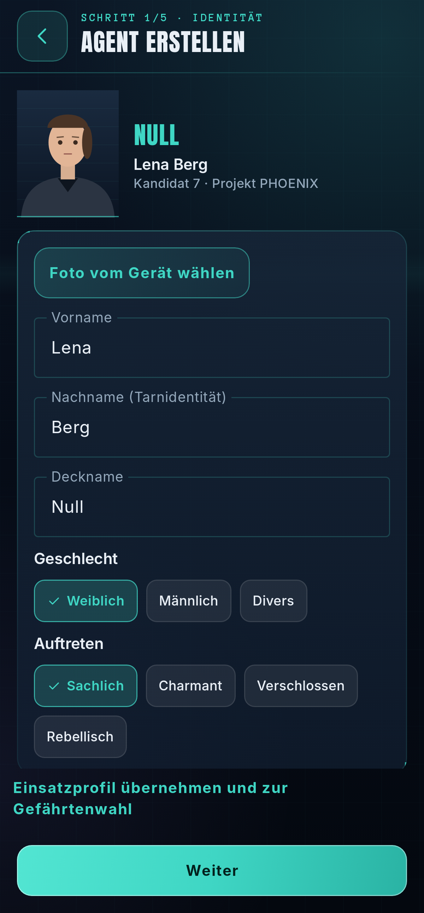
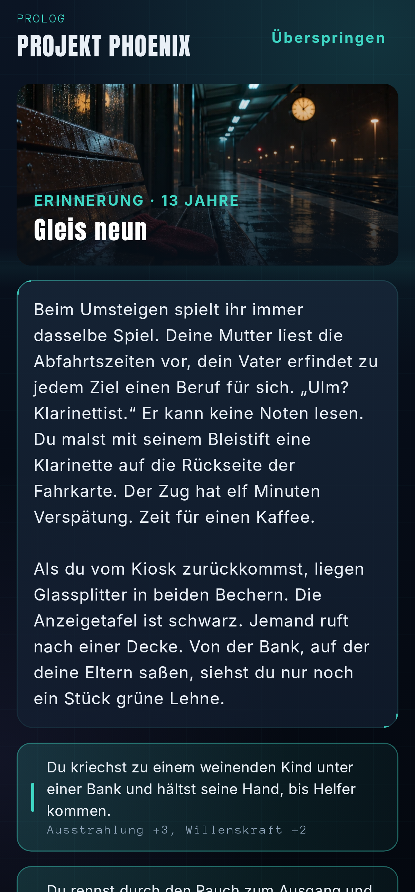
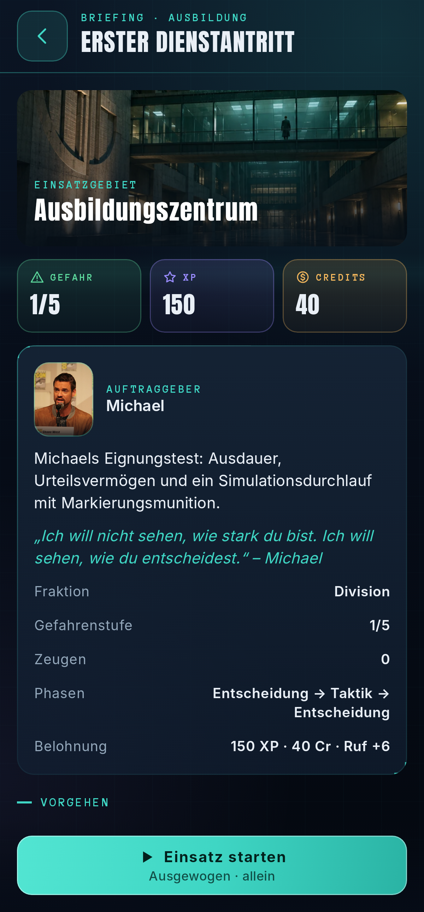
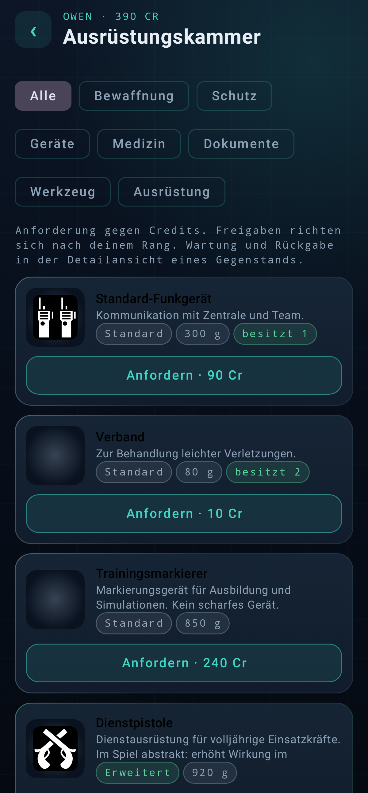
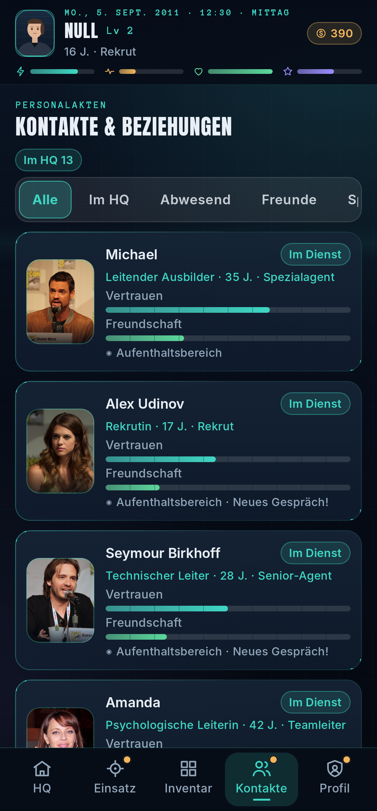
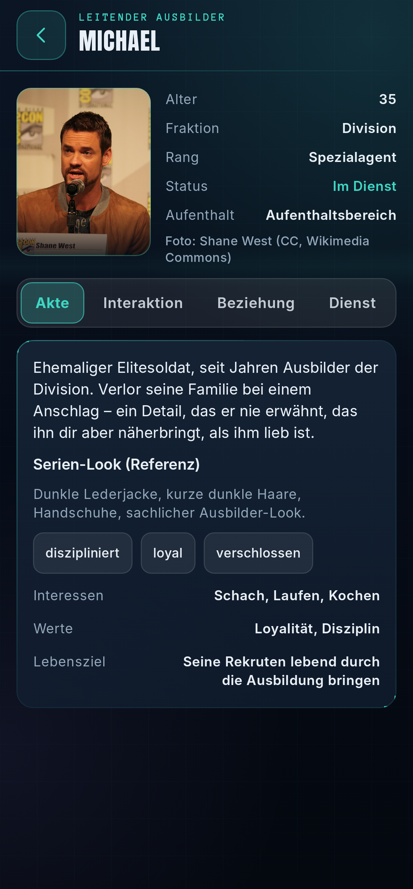
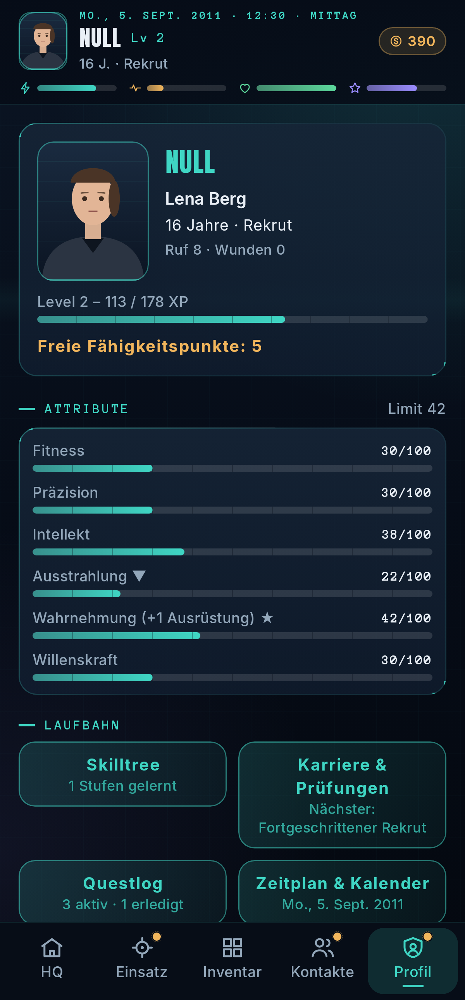
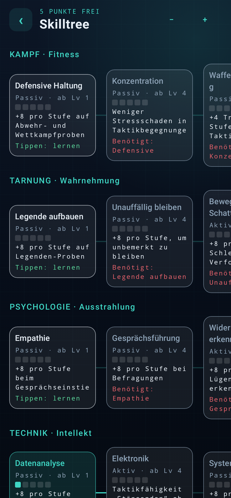

# PROTOKOLL NULL – Aufstieg eines Agenten

Native Android-RPG im Hochformat (Kotlin + Jetpack Compose, offline, deutsch, minSdk 26).
**Stand: spielbare Beta 0.2.0** – Prolog, Kapitel 1 und die Kernsysteme sind spielbar; Kapitel 2 und das Endgame sind teilweise umgesetzt (Details unten).

> Privater, nicht-kommerzieller Fan-Prototyp im Universum der Serie *Nikita* (The CW, 2010–2013). Story, Dialoge und Missionen sind eigenständig geschrieben, keine Episodenabschriften. Für eine öffentliche oder kommerzielle Veröffentlichung sind Rechtefreigaben oder eigenständige Figuren nötig.

## Installation (Debug-APK)

1. Im Repository auf **Actions → Android CI** gehen und den neuesten grünen Lauf öffnen.
2. Unten unter *Artifacts* **`ProtokollNull-debug-apk`** herunterladen (ZIP), entpacken.
3. `app-debug.apk` aufs Android-Gerät (Android 8.0+) kopieren und installieren („Unbekannte Quellen“ erlauben).

Die APK wird bei jedem Push auf `main` neu gebaut; vorher laufen alle Unit-Tests, die Inhaltsvalidierung und ein Render-Test aller Kernscreens.

## Screenshots

Automatisch von Robolectric/Roborazzi aus echtem Spielzustand gerendert (Workflow *Screenshots*, Ordner `docs/screenshots/`). Hinweis: In der Testumgebung lädt Coil Bilder asynchron, daher fehlen auf einigen Aufnahmen Fotos und Item-Icons – auf dem Gerät werden sie angezeigt.

| Start | Charaktereditor | Prolog | Dialog |
|---|---|---|---|
|  |  |  |  |
| **HQ-Lageplan** | **Einsatzboard** | **Briefing** | **Mission** |
|  |  |  |  |
| **Taktikbrett** | **Nachbesprechung** | **Untersuchung** | **Inventar** |
|  |  |  |  |
| **Gegenstand** | **Ausrüstungskammer** | **Kontakte** | **Personalakte** |
|  |  |  |  |
| **Profil** | **Skilltree** | **Ränge** | **Kalender** |
|  |  |  |  |
| **Rekrutierungseditor (ab 18)** | **Direktorat** | **Spielstände** | |
|  |  |  | |

## Was ist spielbar? (ehrlicher Stand)

### ✅ Spielbar
- **Start-/Fortsetzen-Menü**, 3 Speicherslots + Autosave nach jeder Aktion, atomare Speicherung, Import/Export als JSON, automatische Migration alter Foundation-Spielstände (Schema 1 → 2).
- **Charaktereditor** in 4 Schritten: Name, Deckname, Geschlecht, Auftreten, prozeduraler Original-Avatar (Hautton, Frisur, Haarfarbe, Augen, Kleidung, Zubehör), PHOENIX-Hintergrund, Stärke/Schwäche, Schwierigkeitsgrad.
- **Prolog 13–16 Jahre** in 6 erzählten Szenen; Entscheidungen setzen Attribute und Story-Flags (z. B. Gehorsam/Widerstand gegenüber Voss).
- **Kapitel 1 „Neues Blut“** komplett: 9 Quests, **10 handgeschriebene Missionen** (M001–M010) mit Briefing, Vorgehenswahl, Team, Ausrüstungsboni, Abbruch-/Fehlpfaden, Nachbesprechung und Konsequenzen; Kapitelabschluss im Direktorat mit mehreren Ausgängen.
- **Missionstypen**: Entscheidungen mit transparenten Erfolgschancen, Untersuchung (Suchraster mit Hinweisen), Observation (Muster erkennen), Undercover (Tarnungswert), Rettung und **rundenbasiertes abstraktes 2D-Taktikbrett** (Deckung, Bewegung, AP, Status, Teamfähigkeiten, Gegner-KI, deterministische Würfe).
- **Missionsgenerator**: wöchentliches Einsatzboard aus Seeds (Ort, Fraktion, Zeugen, Risiko, Zielperson). Unter 18 nur Gespräche, Untersuchungen und Observationen mit Gefahr ≤ 2.
- **Erkundbares 2D-HQ**: 4 Ebenen, 13 Räume als antippbarer Lageplan, Zutritt nach Rang/Alter/Sicherheitskarte, Raumaktionen, **NPC-Tagespläne** (wer ist wann wo), zufällige Begegnungen.
- **Kalender**: 6 Zeitslots pro Tag, Schlafen/Ausruhen, Erschöpfung ohne Schlaf, Wochensold, Geburtstage, **Zeitraffer** (Woche/Monat/3 Monate/bis 18) in geschlossener Form mit Routinen – keine 365-fach-Schleifen.
- **Werte**: Energie, Stress, Gesundheit, Wunden, Regeneration (Krankenstation, Psychologie, Café, Wohnung).
- **Progression**: Level 1–100, 6 Attribute mit Level-abhängigem Limit, Training mit Partnerbonus, **12 Ränge** mit Level/Alter/Ruf/Vorgesetzten-Vertrauen/Missionen/Story und Prüfung im Direktorat.
- **Skilltree**: 9 Bäume, 36 Fähigkeiten (aktiv/passiv, Levelgrenzen, Voraussetzungen, Meisterperks mit baumübergreifenden Anforderungen), scroll- und zoombar.
- **Inventar** mit Gegenstandsbildern (38 SVGs), 6 Ausrüstungsslots mit Attributboni, Stapeln, Seltenheit, Zustand/Verschleiß, Gewicht/Tragkraft, Spind-Lager, Filter, Detailansicht, Verbrauchsgegenstände, **Ausrüstungskammer** (Anfordern/Warten/Zurückgeben, Rangfreigaben).
- **Beziehungen**: Freundschaft, Vertrauen, Loyalität, Respekt, Zuneigung, Rivalität, Erinnerungen; 22 handgeschriebene, verzweigte Dialoge mit Bedingungen und Proben; Smalltalk, Zeit verbringen, Rat, Geschenke, Wettkämpfe gegen Rivalen.
- **Romanze (altersgerecht)**: nur mit fiktiven Figuren (Maya, Ethan, eigene Rekruten). Zwischen zwei Minderjährigen nur gemeinsame Zeit/Vertrauen/Gespräche, keinerlei sexualisierte Inhalte; zwischen Volljährigen und Minderjährigen grundsätzlich gesperrt. Ab beiderseits 18: Paar, Zusammenziehen (eigene Wohnung), Heirat, Familie.
- **Rekrutierungseditor ab 18**: neue/r 16-jährige/r Agent/in (Standard: anderes Geschlecht) mit Name, Avatar, Charakterzügen, Hintergrund, Startberuf, Interessen und Fähigkeiten; eigenständiger NPC mit Tagesplan, Karriere und Mentoring – nicht sofort Partner/in.
- **Team**: Teamgröße nach Rang, Teammitglieder kämpfen im Taktikmodus mit eigenen Fähigkeiten; ab Rang 8 Teambefehl, ab Rang 9 Delegieren von Aufträgen.
- **Direktorat (Rang 12)**: Budget, 5 Abteilungen mit Ausbau und Leitung, Moral, Aufsicht, Leitlinien, wöchentliche Abrechnung; Abteilungsboni wirken auf Training, Heilung, Intel und Alarm.
- **Ziviles Doppelleben** ab 17/18: Tarnjob, eigene Wohnung, Innenstadt.
- **Einstellungen**: Schriftgröße (S–XL), Animationen, Effektlautstärke, hoher Kontrast, Haptik. **Credits** mit Bild-/Lizenz- und KI-Hinweisen.

### 🟡 Teilweise / in Entwicklung
- **Kapitel 2 „Protokoll Null“**: Missionen M011–M016, Archivrecherche, Nikita-Kontakt und die PHOENIX-Konfrontation sind spielbar, aber kürzer und weniger verzweigt als Kapitel 1.
- **Mehrere Enden**: Story-Flags (Gehorsam, Wahrheit gegenüber Percy, Ablehnung von Voss u. a.) werden gesetzt, eigene Epilog-Sequenzen fehlen noch.
- **Direktor-Endgame**: Verwaltung funktioniert; Fraktionspolitik ist bisher nur als Ansehenswerte und Wochenereignisse umgesetzt.
- **Serien-Look der Figuren**: Die App zeigt die vorhandenen CC-lizenzierten Darstellerfotos (mit Bildausschnitt) plus die Look-Beschreibung aus `assets/SERIES_LOOK_REFERENCES.json`. Der Umschalter auf lizenzierte Serienstills ist eingebaut (siehe unten), aber es sind **keine** Stills im Repo, weil keine Nutzungsrechte vorliegen.
- **Sound**: nur einfache System-Töne für Aktionen; keine Musik.

### ⏳ Geplant
- Weitere Kapitel, NPC-eigene Questreihen, Epiloge/Enden.
- Lizenzierte App-Schriftarten (derzeit Systemschriften).
- Tablet-Layouts, Lokalisierung.

## Figuren-Porträts und Bildrechte

- **Serienfiguren** (Michael, Nikita, Alex, Birkhoff, Amanda, Percy, Thom, Jaden, Owen, Sonya, Ryan): CC-lizenzierte Fotos der Darsteller von Wikimedia Commons (`app/src/main/assets/cast/`, Credits in `assets/CAST_IMAGE_CREDITS.json`). Das sind keine Serienstills und keine Rechte an den Figuren.
- **Serienstills**: Die Szenenbilder in `assets/SERIES_LOOK_REFERENCES.json` sind © The CW bzw. Rechteinhaber und dienen nur als Stilreferenz. Sie werden **nicht** heruntergeladen oder verlinkt. Liegt eine Nutzungserlaubnis vor, kann `app/src/main/assets/cast/show_<id>.jpg` ergänzt und in `app/src/main/assets/licenses/series_image_licenses.json` mit `verified: true`, Lizenz und Nachweis eingetragen werden – erst dann zeigt die App das Still. Ein Test bricht den Build ab, wenn ein `show_*.jpg` ohne Lizenznachweis auftaucht.
- **Fiktive Figuren** (Voss, Maya, Ethan, eigene Rekruten, Spielfigur): prozedural gezeichnete Original-Avatare.
- **Gegenstände**: 32 Icons von game-icons.net (CC BY 3.0), 6 eigene Original-Icons (CC0); siehe `assets/ITEM_IMAGE_CREDITS.json`.

## Technik

- Kotlin 2.0, Jetpack Compose (Material 3, eigenes dunkles Designsystem), AGP 8.7, Gradle-Wrapper 8.9, compile/targetSdk 35, minSdk 26.
- Architektur: `model/` (Kataloge + versionierter `GameState`), `engine/` (reine, deterministische Regeln: Clock, Progression, Inventory, Social/Romance, Missions, Tactical, MissionGenerator, Director, Narrative), `data/` (JSON-Kataloge, `SaveRepository` mit atomarer Speicherung und Migration), `ui/` (`GameViewModel` + Compose-Screens).
- Abweichung vom ursprünglichen Plan: statt Room/DataStore/Navigation werden versionierte JSON-Spielstände (atomar per tmp+fsync+rename) und eine Overlay-Navigation im ViewModel genutzt – offlinefähig, testbar und ohne Annotation-Processing.
- Spielinhalte liegen in `app/src/main/assets/game/` (`agents`, `items`, `skills`, `ranks`, `rooms`, `missions`, `quests`, `dialogues`, `story`, `events`, `places`, `factions`).
- Deterministische Würfe (SplitMix64, Seed + Wurfzähler), persistierte NPC-Beziehungen.

### Build lokal
```bash
./gradlew testDebugUnitTest assembleDebug
./gradlew recordRoborazziDebug   # Screenshots nach docs/screenshots
```

### Tests
- `ContentValidationTest`: Kataloggrößen, eindeutige IDs, alle Asset-Pfade, Serienstill-Lizenzregel, Missions-/Dialog-/Quest-Referenzen, unerreichbare Dialogknoten, Prolog-Graph, Kapitel 1 = 10 Missionen.
- `RulesTest`: Level-100-Grenze, Editor ab 18, Teen-Romanze, Altersabstand, Vertrauens-Clamp, Itemstapel, Gewichtsgrenze, Ausrüstungsfreigaben, Rang-12-Voraussetzungen, Stress/Energie, Zeitraffer, Save-Roundtrip, Migration, Dialogentscheidungen, Missionsablauf, Taktik-Determinismus, Generator-Altersgrenzen, Prolog → Spiel.
- `ScreenshotTest`: rendert 23 Kernscreens mit echtem Spielzustand (Robolectric).

## Changelog

### 0.2.0-beta
- Gradle-Wrapper, GitHub-Actions-CI mit Tests, Render-Smoke-Test und Debug-APK-Artefakt, Screenshot-Workflow.
- Komplett neue Engine und Oberfläche (siehe „Spielbar“), Inhalte für Prolog, Kapitel 1 und Teile von Kapitel 2.
- Migration der Foundation-Spielstände.

### 0.1.0-foundation
- Von ChatGPT erstellte Grundlage: Kataloge, Icons, Darstellerfotos, erste Screens (ohne nachgewiesenen Build).
